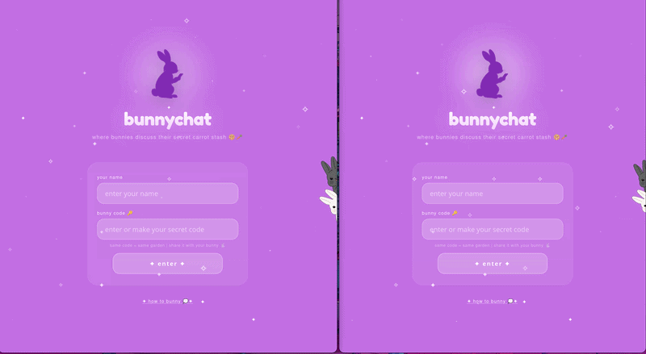

# bunnychat

Real-time web chat app with private rooms, group chat, presence and push notifications.

**Live demo:** https://bunnychat.netlify.app



## Features
- Join a room with your name and a secret code
- Real-time messaging over WebSockets, with group sender labels
- Swipe to reply on mobile
- Online presence and persistent room history (last 200 messages)
- Web Push notifications (service worker, VAPID)
- Input validation and payload size limits on the server
- Mobile-first UI, including an iOS keyboard fix

## Tech stack
Node.js + WebSocket server · Netlify (frontend) · Render (backend)

## Run locally
```bash
git clone https://github.com/sra1st/bunnychat.git
cd bunnychat/backend
npm install
node server.js
```
Then open `frontend/index.html` in a browser.

## Project structure
- `frontend/` — web client
- `backend/` — WebSocket server (`server.js`)

## Author
adi 
